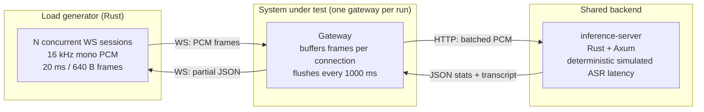

# websocket-stt-bench

## How many concurrent websocket audio-streaming sessions can modern runtimes sustain per vCPU?


This repo benchmarks streaming STT gateways behind one shared WebSocket protocol. Clients stream 16 kHz mono PCM at 20 ms / 640-byte frames; each gateway buffers per session, flushes every 1000 ms to a shared Rust inference simulator, and returns strict `partial` JSON messages.

Inspired by the [Benchmarks Game](https://benchmarksgame-team.pages.debian.net/benchmarksgame/index.html) and Karpathy's [autoresearch](https://github.com/karpathy/autoresearch).

## TL;DR

*Concurrent WebSocket sessions sustained inside the [SLO](#the-slo-what-passing-means):*


| Runtime | 1 vCPU | 2 vCPU | What fails first | App LOC | Details |
|---|---:|---:|---|---:|---|
| **[Rust 1.95](https://github.com/rust-lang/rust) — two `mio`/epoll threads, **no async runtime**** | **4800** | 5100 (1.06X)¶ | newest-p50 latency | 1221 | [runs](services/rust-sync/BENCHMARK.md) |
| **[C++23](https://en.cppreference.com/w/cpp/23) + [uWebSockets 20.77](https://github.com/uNetworking/uWebSockets)** | 4100 | **5800**◆ (1.41X) | newest-p50 latency | 1.6k | [runs](services/cpp23-uwebsockets/BENCHMARK.md) |
| **[Rust 1.95](https://github.com/rust-lang/rust) + async [Axum](https://github.com/tokio-rs/axum) / [Tokio](https://github.com/tokio-rs/tokio)** | 3350 | 5000 (1.49X) | newest-p95 latency | 696 | [runs](services/rust-axum/BENCHMARK.md) |
| **`oxcaml-epoll` — [OxCaml 5.2.0+ox](https://oxcaml.org/), Linux epoll, no Async** | 3000 | 3000§ (1.00X) | newest-p50 latency | 1.7k | [runs](services/ocaml-oxcaml-epoll/BENCHMARK.md) |
| **[TypeScript](https://www.typescriptlang.org/) on [Bun 1.3.13](https://bun.sh/)** | 2750 | not measured | inference `fetch` timeouts (not CPU) | 734 | [runs](services/typescript-bun/BENCHMARK.md) |
| **[Java 25 LTS](https://openjdk.org/projects/jdk/25/) + [Helidon Níma 4.3](https://helidon.io/)** | 2500 | 3900 (1.56X) | tail-latency cliff at 1 vCPU (newest p95 >1.5 s); newest-p95 latency at 2 vCPU | 917 | [runs](services/java-helidon-nima/BENCHMARK.md) |
| **[Go 1.26.10](https://go.dev/) + `net/http` / [`coder/websocket`](https://github.com/coder/websocket)** | 2500 | 3050 (1.22X)‡ | latency (2 vCPU: newest p95 at ~1.4 cores) | 893 | [runs](services/go-nethttp/BENCHMARK.md) |
| **[OxCaml 5.2.0+ox](https://oxcaml.org/) + Async** | 2100 | 2025§ (0.96X) | newest-p50 latency, single Async domain | 879 | [runs](services/ocaml-oxcaml/BENCHMARK.md) |
| **OCaml 5.4.1 + Async** | 1800 | 1850§ (1.03X) | newest-p50 latency, single Async domain | 850 | [runs](services/ocaml-websocket-async/BENCHMARK.md) |
| **[Elixir 1.19.5](https://github.com/elixir-lang/elixir) + [Phoenix](https://github.com/phoenixframework/phoenix) / [Bandit](https://github.com/mtrudel/bandit)** | 1250 | 2200 (1.76X) | newest-p50 latency | 784 | [runs](services/elixir-phoenix/BENCHMARK.md) |
| **[CPython 3.15.2](https://github.com/python/cpython) (GIL) + uvloop + FastAPI / Granian** | 1250 | 1900 (1.52X)† | newest-p50 latency | 678 | [runs](services/python-fastapi/BENCHMARK.md) |
| **[CPython 3.15.2t](https://github.com/python/cpython) free-threaded + uvloop + FastAPI / Granian** | 1250 | 2000 (1.60X)† | newest-p50 latency | 678 | [runs](services/python-fastapi/BENCHMARK.md) |
| **[Scala 3.3 LTS](https://www.scala-lang.org/) + [Apache Pekko 1.6](https://pekko.apache.org/)** | 1150 | 1850 (1.61X) | newest-p95 latency | 726 | [runs](services/scala-pekko/BENCHMARK.md) |

**How these numbers were measured (2026-11-02/03 homelab runs).** Everything ran on one k3s node (i9-13900F), each pod pinned to fixed P-cores: the gateway on 0,2 (one hyperthread on each of two P-cores, with a 1- or 2-vCPU CFS quota and 4 GiB), the Rust load generator on 4-11 (8 CPUs, 8 Tokio workers), and the shared inference server on 12-15 (3 replicas; it never used more than 1.3 cores and was never throttled). Every gateway first passed the 7-case in-cluster black-box conformance suite on the exact images measured. Every measured partial was verified client-side for exact stub values and per-session frame continuity, and any correctness error fails the point. "Confirmed" means every repeat at that point passed (at least 2/2) and the next step up failed. Each table number is the lowest confirmed value across two full, independent passes (run3 and run4) plus targeted re-runs (the OCaml 2-vCPU numbers come from two separate 2-vCPU passes, run6a/b); the passes agreed within one bisection step for every runtime except C++ at 2 vCPU (◆). Four results (C++ 1 vCPU in both passes, Elixir 2 vCPU in run4, one C++ 2-vCPU re-run) were lower bounds because of a sweep bug — after a failed confirmation it fell back to an older passing probe instead of stepping down one step, leaving the next step untested; the bug is fixed and the first three were re-measured twice with the fixed sweep (C++ 1 vCPU 4100/4100, Elixir 2 vCPU 2200/2200, matching run3's 2200). The loadgen is close to its 8 cores (≥ 85%, flagged by the sweep) at the top points of rust-sync, async Rust at 2 vCPU and C++ at 2 vCPU; an A/B giving it 10 cores (which also squeezed inference from cores 12-15 onto 14-15, a confound) did not move the rust-sync 1-vCPU fail (2/2 still failing), async Rust 2 vCPU passed 5050 either way, C++ 2 vCPU at 6450 got worse, and rust-sync 2 vCPU at 5300 was inconclusive (one pass, one run that produced no result). Elsewhere it stayed under about 75% (at most 5.8 of 8 cores). The gateway was the bottleneck, saturating its CPU quota except where noted (¶ ‡ §, and Bun). Re-tests of a few first-failing points passed (Go 2 vCPU 3200, Bun 2800, async Rust 2 vCPU 5050), so read every ceiling as ±1 step.

**Validation.** The harness was checked by mutation testing (13 deliberately broken builds of the Rust gateway — wrong stub values, frame-accounting errors such as dropped or duplicated partials, wrong close codes and start-message handling, a 1% frame drop, +150 ms of added delay — each one failed conformance or the SLO evaluation; the unmodified build passes both) and by latency calibration against a reference gateway with injected delays of 0-300 ms (measured latency within 8 ms of the expected value; latency is measured from scheduled send times, so coordinated omission is accounted for). One known bias: a session's last partial that arrives after the measurement window closes is not counted, which can slightly understate the tail of points that are already failing; it does not move a passing point.

**What moved since the 2026-10-28 split-node numbers.** Those ran inference on a second node over the LAN with an unpinned gateway; they remain as history in each service's BENCHMARK.md. Two causes were isolated by A/B at the new ceilings: (1) **pinning**: allowed on all CPUs, the gateway mostly ran on the loadgen's and inference's P-cores (host `/proc/stat`: cores 0,2 went idle, the loadgen's cores 4-11 or inference's 12-15 got busier, the E-cores stayed idle except for Scala), so gateway and loadgen competed for the same cores; pinned to 0,2 vs. allowed on all CPUs, rust-sync 4800, Bun 2750, oxcaml-epoll 3000 and Python 3.15 GIL 1250 each passed 2/2 pinned and failed 2/2 unpinned (rust-sync newest p50 196 → 419-469 ms), and Scala 1150, at its own edge, passed 1 of 2 pinned and failed 2/2 unpinned (error frames); (2) **co-locating inference** (no LAN hop), which earlier cost C++ about 20%. Scala's 600 → 1150 is pinning plus its 3 GiB heap: at 1150, pinned, the old 1536 MiB heap / 2 GiB pod failed 2/2 (newest p95 579-601 ms) against 292-475 ms with 3 GiB (which itself passed 1 of 2 there — 1150 is Scala's edge). Python is now CPython 3.15.2/3.15.2t (was 3.14.4/3.14.4t): the free-threaded build's 175 was a Granian lost-wakeup bug fixed in Granian 2.8.7; in run3, measured side by side, 3.14 and 3.15 were within one step of each other with the GIL (1250/1900 both) and 3.15t led 3.14t (1250 vs 1150, 2000 vs 1800).

¶ No async runtime, zero new dependencies, plain HTTP/1.1. Two OS threads — a `mio`/epoll WebSocket loop + a dedicated inference loop (`std::sync::mpsc` + `mio::Waker`). The design cannot use more than about 1.14 cores, so 2 vCPU barely helps (run3 5100, run4 5200).
◆ C++ 2 vCPU is not stable to one step: valid sweeps confirmed 6300, 5900, 5900 and 5800 (a fifth, 5700, had the sweep bug above and is only a lower bound; single points passed up to 6700). Its first gate, newest p50 ≤ 200 ms, hovers around 200 ms (192-231 ms across sweeps) everywhere from 5850 to 6750 sessions, so noise moves the ceiling; occasional burst failures (gateway memory to 2-2.9 GiB plus error frames) also depress the next points, because the sweep doesn't restart the gateway between points. The lowest is shown; read it as 5800-6300.
‡ Go at 2 vCPU fails the newest-p95 gate while using about 1.4 of its 2 cores, with no CPU throttling; host-side `/proc/stat` on cores 0 and 2 confirms they are not saturated. The cause (scheduler, GC or lock contention) was not isolated.
§ A single event loop / Async domain: a 2-vCPU pod can't use the second core (each used exactly 1.00 core at its first failing point), so 2 vCPU ≈ 1 vCPU. Measured in two separate 2-vCPU passes (run6a/b), which agreed within one step.
† Python 2 vCPU runs `GRANIAN_LOOPS=2` / `WORKER_THREADS=2`.
Bun at 1 vCPU uses about 0.8 of its core; it fails abruptly at 2800-2900 when its `fetch` client starts timing out on inference requests (at 2900 in run3: 12,843 timeouts and 1,163 connection resets, plus 1,085 sessions whose final frames were never reported, while inference was idle at 0.4 cores), not on CPU.

LOC note: the TL;DR and chart use LOC. For OCaml raw-transport variants, that excludes the generic first-party WebSocket/HTTP/SHA-1/base64/masking transport shim that package-backed runtimes get from dependencies. Comments and blank lines are not counted.

Detailed brackets, tables, and run notes live in the linked service benchmark docs; raw logs are under `results/homelab/` (gitignored) and the tracked harness is `scripts/bench/homelab/`.

**Hardware:** Intel Core i9-13900F (8 P-cores with hyperthreading + 16 E-cores), 64 GiB, Ubuntu 24.04.3, k3s v1.35.4.

## Takeaways

*Written against the earlier single-node runs; the figures quoted below are those runs' numbers. On the 2026-11 pinned, co-located runs: rust-sync leads at 1 vCPU (4800) and C++ at 2 vCPU (5800-6300); async Rust is third; Bun moves ahead of Java and Go at 1 vCPU; Scala recovers to 1150 / 1850 (pinning plus heap) and now fails on newest-p95 latency with zero errors, so its connect-timeout caveat is gone; OxCaml/Async is at 2100; and free-threaded Python 3.15t is no longer reliability-limited — it ties the GIL build at 1 vCPU and edges it at 2.*

- The biggest surprise: the per-vCPU leader is **Rust **, specifically a two-thread `mio`/epoll build (one WebSocket loop, one inference loop, plain HTTP/1.1, zero extra deps) at 4400 sessions/vCPU, just past C++ (4350).
- Async Rust is still the best *balance*: @ 696 LOC and 3475 sessions/vCPU, the leanest of the high-capacity tier even though raw-capacity now goes to the no-runtime Rust build. Both Claude Opus (max) and GPT 4.5 (xhigh) had no issue writing Rust.
- Tail-latency SLOs expose GC jitter. Passing requires p95 frame latency, not just average throughput, so allocation pressure, safepoints, and collection pauses can turn otherwise healthy throughput into latency cliffs. The size of that penalty is stack- and tuning-dependent, not a blanket verdict on every GC runtime.
- Two managed-runtime clusters show up. `oxcaml-epoll`, Java, Bun, and Go form the fast GC/managed tier around 2500-2900 sessions/vCPU, with the no-Async OxCaml epoll variant now ahead of Java on the 1-vCPU confirmed point. Actor-style runtimes cluster lower at 1 vCPU: Elixir/BEAM at 1250 and Scala/Pekko at 1400, though both land near 2200-2250 at 2 vCPU; Scala still has a connect-timeout caveat.
- BEAM scales vertically really well but dissapoints overall: Elixir trails at 1 vCPU but has the cleanest 1→2 vCPU lift. Similar story with Scala + actor framework. Perhaps this is a actor concurency model issue overall? TODO: investigate this.
- Bun is surprisingly competitive for a native WebSocket server path. It simply has no right beating Go and coming incredibly close to Java. Great job Bun! 👏
- OxCaml splits into two useful data points. The Async implementation got close-ish only after raw transport work: persistent keep-alive + zero-copy framing moved the confirmed ceiling from 1050 to 2075, then GC/runtime tuning plus a lighter session buffer lifted the latest 1-vCPU point to 2200. The separate `oxcaml-epoll` variant removes Async entirely; after widening its non-multiplexed HTTP/1.1 inference slot pool from 512 to 1024, it reached 2900 confirmed and 3000 borderline, where the failure shifted from pool-exhaustion error frames to newest-p50 latency. Jane Street looks to have made some noticeable improvements over OCaml with their fork. There are downsides as I couldn't use the standard async ocaml websockets framework with their fork, alas Claude had no problem writing a simple one from scratch. For a GC'ed non JVM language the perf seems impressive enough to me, it also reads extremely elegantly, only Elixir comes close.
- The stock OCaml gap was mostly transport: replacing `cohttp-async` + `websocket-async` with the same raw Async TCP shape moved stock OCaml to 1930, within about 7% of OxCaml's earlier raw-transport baseline before the later GC/buffer tuning.
- Free-threaded Python with this FastAPI/Granian stack has issues; TODO: investigate this.
- Some languages/runtimes were easier to prompt for than others. Rust and Python took me one or two prompts. C++ needed me to take over and repeatedly steer towards C++ concepts I have long forgotten (RAII, move semantics, etc); OxCaml was easy but building was downright painful (30m or so to build, OxCaml desperately needs better tooling like pre-built docker images).

**Pareto frontier (1 vCPU, 2026-11 numbers):** Python 3.15 GIL and free-threaded (678 LOC / 1250 sessions, leanest) · Async Rust/Tokio (696 LOC / 3350, best balance) · Rust/`mio` no-runtime (1221 LOC / 4800, most capacity). C++23 (1551 LOC / 4100) is dominated by the no-runtime Rust build at 1 vCPU, but has the highest 2-vCPU ceiling.

## The SLO: what "passing" means

"Passing" means every gate below holds against loadgen HDR histograms, per audio frame:

| Gate | Threshold | What it bounds |
|---|---:|---|
| **Newest-frame p50** | **≤ 200 ms** | Responsiveness to freshest audio in a flushed batch |
| Newest-frame p95 | ≤ 350 ms | Tail on fresh audio |
| **Oldest-frame p50** | **≤ 1200 ms** | Worst per-frame wait after the 1000 ms flush interval |
| Oldest-frame p95 | ≤ 1650 ms | Tail on oldest buffered audio |
| **Errors** | **≤ 1 / 100k partials** | Protocol errors (including timeouts) plus inference error frames |
| **Correctness** | **0 errors** | Every partial verified: wrong stub values, dropped or misattributed frames |

Errors count each failure once: `max(protocol_errors, sum of timeouts) + inference_errors` (a timed-out session is already a protocol error). A point also fails on any correctness error — a partial whose stub values don't match what the loadgen recomputes from the frames that session actually sent (so misattributed frames fail too), or a gap/overlap in the session's frame sequence (dropped or duplicated frames) — regardless of latency.

The error budget tolerates kernel/TCP stall noise while staying far tighter than typical production STT targets.

## What this experiment measures

The gateways share the same black-box WebSocket contract:

- `GET /ws/stt` upgrades to WebSocket; `GET /health` returns 200.
- Client sends `{"type":"start"}` as text, then 640-byte binary PCM frames at 50 fps.
- Gateway flushes every 1000 ms to a shared Rust inference simulator.
- Gateway holds at most one in-flight inference request per connection.
- Gateway returns strict `partial` JSON with `oldest_frame_seq`, `newest_frame_seq`, `flush_lateness_ms`, and `inflight_model_jobs`.
- Invalid first message closes with `1002`; invalid binary frame size closes with `1003`.

The shared inference server is deterministic and simulates GPU-style latency with log-normal jitter, batch wait, and long-tail spikes. It is not a real ASR model. Real ASR weights, authentication, multi-tenancy, segmentation, retry/reconnect logic, and VAD are intentionally out of scope.

## Architecture



## Code Shape

| Runtime | App LOC | Raw production LOC | Files | Implementation shape |
|---|---:|---:|---:|---|
| Python | 678 | 678 | 9 | Pydantic boundaries, uvloop/FastAPI, dual GIL/free-threaded runtime path |
| Async Rust/Axum | 696 | 696 | 6 | Tokio tasks, `Arc<Semaphore>::new(1)`, zero-copy `BytesMut` batching |
| TypeScript/Bun | 734 | 734 | 6 | `Bun.serve`, Valibot boundaries, bounded outbox |
| Elixir | 784 | 784 | 13 | Phoenix/Bandit raw `WebSock`, process-per-connection |
| Go | 893 | 893 | 6 | `net/http`, `coder/websocket`, h2c inference client |
| Java | 917 | 917 | 16 | Helidon Níma virtual threads, sealed outbound messages |
| Stock OCaml/Async | 850 | 1220 | 25 | raw `Async.Tcp`, hand-rolled RFC 6455, structural one-inflight flush loop |
| Rust/sync (`mio`) | 1221 | 1221 | 6 | two `mio` epoll loops on two OS threads (no async runtime), `mpsc`+`Waker` handoff, bounded shared inference pool |
| `oxcaml-epoll` | 1680 | 2126 | 15 | single Linux epoll loop, tiny C epoll stubs, fixed-frame WebSocket path, HTTP/1.1 inference slot pool |
| OxCaml | 879 | 1244 | 21 | raw `Async.Tcp`, hand-rolled RFC 6455, opaque inflight capability |
| C++23 | 1551 | 1551 | 11 | uWebSockets loop-per-thread, libcurl HTTP/2, Glaze JSON |

Application LOC is the chart count: code-only production lines after excluding blank/comment lines. For the OCaml raw-transport variants, it also excludes the generic first-party transport/crypto shim (`Base64`, `Sha1`, HTTP helpers, WebSocket framing/handshake, masking) that package-backed runtimes get from dependencies. Raw production LOC keeps every shipped first-party production line, including that shim. The no-runtime Rust gateway uses no such shim, so its two counts are equal.

The load-bearing invariant is one in-flight inference request per connection. Every implementation enforces it, but the expression differs: semaphore, atomic flag, token channel, process state, task guard, sequential flush loop, `Mvar`-backed capability, or — in the no-runtime Rust gateway — the single shared-pool inference slot a connection holds while its request is in flight.

## Which runtime?

| If you optimize for | Pick | Why |
|---|---|---|
| Lowest dollars per session (1 vCPU) | Rust/`mio` (no runtime) | 4800 sessions/vCPU, memory-safe, no async runtime — beats C++ (4100) |
| Leanest of the high-capacity tier | Async Rust/Axum | 3350 sessions/vCPU in 696 LOC; 5000 at 2 vCPU |
| Most sessions per pod at 2 vCPU | C++23/uWebSockets | 5800-6300 at 2 vCPU (the highest), 4100 at 1 vCPU |
| Rust-adjacent JVM capacity | Java/Helidon Níma | 2500 sessions/vCPU, 3900 at 2 vCPU; past the edge, tail latency collapses |
| Above-Java OxCaml capacity | `oxcaml-epoll` | 3000 sessions/vCPU; separate no-Async variant, newest-p50 latency edge at 3100 |
| JS ecosystem with strong capacity | TypeScript on Bun | 2750 sessions/vCPU on native Bun primitives; its `fetch` client is the limit |
| Go operational simplicity | Go/net-http | 2500 sessions/vCPU and explicit h2c transport |
| Vertical multi-core scale-up | Elixir / Scala / Python 3.15t | 1.76X / 1.61X / 1.60X lift 1→2 vCPU (C++ 1.41X-1.54X, async Rust 1.49X) |
| Modeling invariants as types | OxCaml | opaque inflight capability, still runtime-enforced |
| Upstream OCaml without OxCaml | Stock OCaml/Async raw transport | within about 7% of the earlier OxCaml raw-transport baseline once transport is held roughly constant |
| Free-threaded Python | CPython 3.15.2t | ties the 3.15.2 GIL build at 1 vCPU (1250) and edges it at 2 vCPU (2000 vs 1900) |

My hot-take? If you're at a startup, start with async Python, iterate and once you need to do some cost savings, either commit to a full, coding agent driven, Rust rewrite, or swap out the bottlenck components via Rust-based cPython extension modules (serialization, websockets, etc). Else, just start in Rust. Yes, the hype is real!

## Reproducing

```sh
just doctor          # verify pinned tool versions
just check           # full per-language gate
just compose-build   # build all images
just conformance     # protocol contract check
just bench-ladder rust-axum-single ws://127.0.0.1:3000/ws/stt
```

The Python gateway's interpreters (CPython 3.15.2t / 3.15.2) are container-only, so `just python-check` (part of `just check`) runs in Docker.

Local Compose runs the `single` or `multi` profile one at a time because profiles share host ports. Multi-vCPU capacity claims should be verified in-cluster; Compose under-reports once the gateway outpaces the in-VM inference simulator.

For reproducible Kubernetes runs, use `charts/stt-bench/` and `charts/stt-bench/README.md`. The chart renders the inference server, gateway Deployments, suspended loadgen/inferbench Jobs, and results PVC. Analysis uses paired `*.summary.json` / `*.samples.csv` artifacts:

```sh
just analyze-results <input-dir> <output-dir>
```

## Environment

- **Load generator:** `loadgen/rust/`, `tokio-tungstenite`, HDR histograms, strict `partial` validation.
- **k3s node:** Intel Core i9-13900F, 32 logical CPUs, 64 GiB RAM, Ubuntu 24.04.3, k3s v1.35.4.
- **2026-11 runs:** gateway, loadgen and inference all on that node, each pinned to fixed P-cores (gateway 0,2; loadgen 4-11; inference 12-15) by `taskset` (a `cpu-pin` sidecar for gateways); placement in `charts/stt-bench/values-colocated.yaml`, sweeps via `scripts/bench/homelab/full-pass.sh`.
- **Scheduling caveat:** Kubernetes CPU limits are CFS quota, not affinity. On this hybrid CPU an unpinned gateway competes with the loadgen and inference for their P-cores; the unpinned co-located pass (run2) came in up to 21% lower, and the A/B above flips ceilings from pass to fail, so the pinning is part of the setup, not an optimization. Repeats and raw sample CSVs are the evidence.
- **Pinned versions:** `versions.lock.toml`.

## Known gaps

The current setup models compute saturation but not every backpressure path. Open: bounded per-connection input buffers with overflow policy, client-side send-wait time as a KPI, per-connection queue/drop metrics, a cross-connection job-queue limit, and overload conformance/stress checks.

**Inference-server placement:** local Compose under-reports fast gateway capacity once the gateway can outpace the in-VM simulator. Use the in-cluster path for capacity claims.

## Disclosure

This repo was created with assistance from ChatGPT 5.5 and Claude Opus 4.7.
