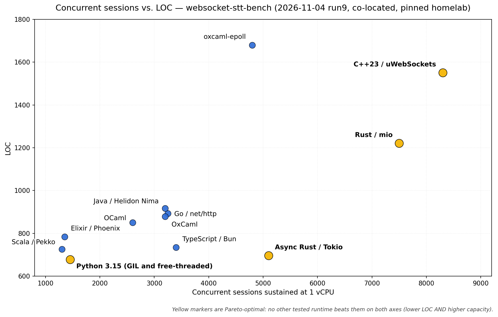
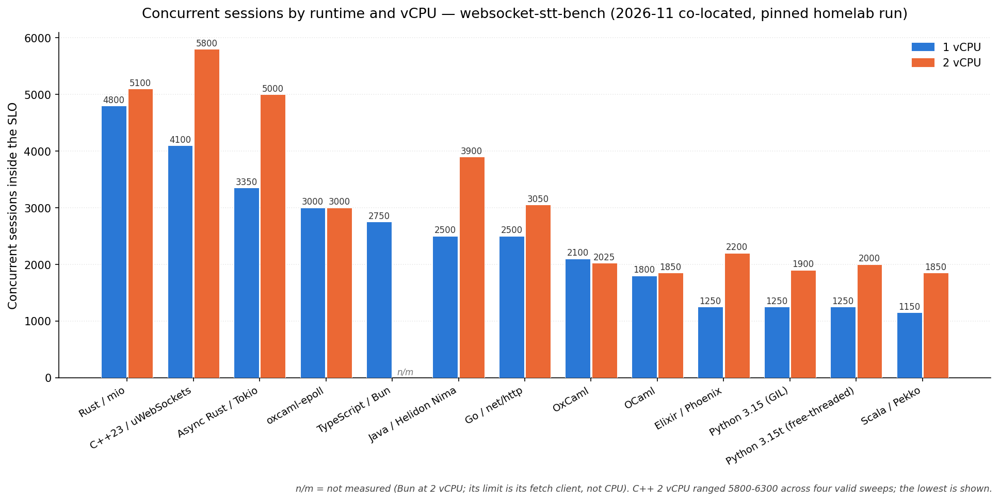
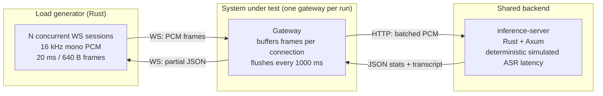

# websocket-stt-bench

## How many concurrent websocket audio-streaming sessions can modern runtimes sustain per vCPU?


This repo benchmarks streaming STT gateways behind one shared WebSocket protocol. Clients stream 16 kHz mono PCM at 20 ms / 640-byte frames; each gateway buffers per session, flushes every 1000 ms to a shared Rust inference simulator, and returns strict `partial` JSON messages.

Inspired by the [Benchmarks Game](https://benchmarksgame-team.pages.debian.net/benchmarksgame/index.html) and Karpathy's [autoresearch](https://github.com/karpathy/autoresearch).

## TL;DR

*Concurrent WebSocket sessions sustained inside the [SLO](#the-slo-what-passing-means):*



| Runtime | 1 vCPU | 2 vCPU | What fails first | App LOC | Details |
|---|---:|---:|---|---:|---|
| **[C++23](https://en.cppreference.com/w/cpp/23) + [uWebSockets 20.77](https://github.com/uNetworking/uWebSockets)** | **8300** | **9000**◆ (1.08X) | newest-p50 latency (2 vCPU: inference-request timeouts) | 1.6k | [runs](services/cpp23-uwebsockets/BENCHMARK.md) |
| **[Rust 1.95](https://github.com/rust-lang/rust) — two `mio`/epoll threads, **no async runtime**** | 7500 | 8700 (1.16X)¶ | newest-p50 latency | 1221 | [runs](services/rust-sync/BENCHMARK.md) |
| **[Rust 1.95](https://github.com/rust-lang/rust) + async [Axum](https://github.com/tokio-rs/axum) / [Tokio](https://github.com/tokio-rs/tokio)** | 5100 | 8300 (1.63X) | newest-p95 latency (2 vCPU: newest p50) | 696 | [runs](services/rust-axum/BENCHMARK.md) |
| **`oxcaml-epoll` — [OxCaml 5.2.0+ox](https://oxcaml.org/), Linux epoll, no Async** | 4800 | —§ | error frames: inference slot pool exhausted | 1.7k | [runs](services/ocaml-oxcaml-epoll/BENCHMARK.md) |
| **[TypeScript](https://www.typescriptlang.org/) on [Bun 1.3.13](https://bun.sh/)** | 3400 | not measured | inference `fetch` timeouts (not CPU) | 734 | [runs](services/typescript-bun/BENCHMARK.md) |
| **[Go 1.26.10](https://go.dev/) + `net/http` / [`coder/websocket`](https://github.com/coder/websocket)** | 3250 | 4400 (1.35X)‡ | latency (2 vCPU: newest p95 at ~1.4 cores) | 893 | [runs](services/go-nethttp/BENCHMARK.md) |
| **[Java 25 LTS](https://openjdk.org/projects/jdk/25/) + [Helidon Níma 4.3](https://helidon.io/)** | 3200 | 5600 (1.75X) | tail-latency cliff (newest p95 0.5-3.7 s one step past the edge) | 917 | [runs](services/java-helidon-nima/BENCHMARK.md) |
| **[OxCaml 5.2.0+ox](https://oxcaml.org/) + Async** | 3200 | —§ | newest-p50 latency, single Async domain | 879 | [runs](services/ocaml-oxcaml/BENCHMARK.md) |
| **OCaml 5.4.1 + Async** | 2600 | —§ | newest-p50 latency, single Async domain | 850 | [runs](services/ocaml-websocket-async/BENCHMARK.md) |
| **[CPython 3.15.2](https://github.com/python/cpython) (GIL) + uvloop + FastAPI / Granian** | 1450 | 1950 (1.34X)† | newest-p50 latency (2 vCPU: error budget, 2 connect timeouts) | 678 | [runs](services/python-fastapi/BENCHMARK.md) |
| **[CPython 3.15.2t](https://github.com/python/cpython) free-threaded + uvloop + FastAPI / Granian** | 1450 | 2500 (1.72X)† | newest-p50 latency | 678 | [runs](services/python-fastapi/BENCHMARK.md) |
| **[Elixir 1.19.5](https://github.com/elixir-lang/elixir) + [Phoenix](https://github.com/phoenixframework/phoenix) / [Bandit](https://github.com/mtrudel/bandit)** | 1350 | 2400 (1.78X) | newest-p50 latency | 784 | [runs](services/elixir-phoenix/BENCHMARK.md) |
| **[Scala 3.3 LTS](https://www.scala-lang.org/) + [Apache Pekko 1.6](https://pekko.apache.org/)** | 1300 | 2050 (1.58X) | newest-p95 latency | 726 | [runs](services/scala-pekko/BENCHMARK.md) |

**How these numbers were measured (2026-11-04 homelab run, "run9").** Everything ran on one k3s node (i9-13900F), each pod pinned to fixed P-cores: the gateway on 0,2 (one hyperthread on each of two P-cores, with a 1- or 2-vCPU CFS quota and 4 GiB), the Rust load generator on 4-11 (8 CPUs, 8 Tokio workers), and the shared inference server on 12-15 (3 replicas, never throttled). Every gateway first passed the 7-case in-cluster black-box conformance suite on the exact images measured (2-vCPU shapes run the same images and were admitted on their 1-vCPU conformance). Every measured partial at every passing point was verified client-side for exact stub values and per-session frame continuity, and any correctness error fails the point. "Confirmed" means every repeat at that point passed (at least 2/2) and the next step up failed. Harness integrity is part of the verdict: a missing or malformed summary, a crashed loadgen, a panicked session task, incomplete verification on a would-be pass, or loadgen send lag p99 > 10 ms (not explained by gateway back-pressure) makes a point INVALID and it is re-run, never counted as a pass or a fail. In run9 every ceiling was set by the gateway failing; no point was capped by the harness; at every passing point the loadgen's send lag stayed ≤ 5 ms at p99 and it used at most 5.5 of its 8 cores. (Past Java's 2-vCPU cliff, send lag reached 1.9 s at p99 because the gateway stopped reading and then closed 2,583 sessions; those points fail on the observed closes.) This is a single full pass (one sweep per runtime and shape), so read every ceiling as ±1 step; gateways measured twice on this setup (Go, rust-sync, async Rust at 1 vCPU, in run8 and run9) agreed within 100 sessions. Above about 7500 sessions the loadgen's send-lag p999 rises to 45-62 ms at passing points (p99 stays ≤ 5 ms), and at 9100+ sessions its verifier starts dropping partials on failing points, so the top of the table is near the edge of what this harness has been validated for.

**Validation.** The harness was checked by mutation testing (13 deliberately broken builds of the Rust gateway — wrong stub values, frame-accounting errors such as dropped or duplicated partials, wrong close codes and start-message handling, a 1% frame drop, +150 ms of added delay — each one failed conformance or the SLO evaluation; the unmodified build passes both) and by latency calibration against a reference gateway with injected delays of 0-300 ms (relative to the 0 ms run, measured newest p50 tracks the injected delay to within 3 ms, and the median per-frame residual against a timing model is 1.6-2.7 ms; latency is measured from scheduled send times, so coordinated omission is accounted for). That validation predates the run9 loadgen and was done at low load; re-running it at the run9 ceilings is open work ([harness spec](docs/HARNESS_RECORDING_SPEC.md)). One known bias: a session's last partial that arrives after the measurement window closes is not counted, which can slightly understate the tail of points that are already failing; it does not move a passing point.

**What moved since the 2026-11-02/03 numbers (run3/run4).** Same node, pod shape, pinning, gateway images and SLO; what changed is the load generator, plus a k3s upgrade on the node. The old loadgen gave each session tungstenite's default 128 KiB read buffer, which tungstenite zero-fills before every read attempt; with every session polling its reader on each 20 ms send tick, that memset dominated the loadgen's CPU and its lateness was charged to the gateway as latency (latency is measured from scheduled send times). It also left Nagle on (`TCP_NODELAY` off) for 640-byte frames. The fixed loadgen (4 KiB buffer, `TCP_NODELAY`) uses about 2.5× less CPU at the same load, and every ceiling rose: by 44-102% for the event-loop gateways (C++, OCaml variants, both Rust builds), 24-30% for Bun, Go and Java at 1 vCPU, and 8-16% for runtimes that top out below 1500 sessions. The k3s upgrade (v1.35.4 → v1.37.1) is a confound: an interleaved old-vs-new loadgen A/B on the current node, which would split the two effects, has not been run, so the size of each runtime's change is not fully attributed. Comparisons within the table are like-for-like either way.

**Earlier: what moved since the 2026-10-28 split-node numbers.** Those ran inference on a second node over the LAN with an unpinned gateway; they remain as history in each service's BENCHMARK.md. Two causes: (1) **pinning**, isolated by A/B at the new ceilings: allowed on all CPUs, the gateway mostly ran on the loadgen's and inference's P-cores (host `/proc/stat`: cores 0,2 went idle, the loadgen's cores 4-11 or inference's 12-15 got busier, the E-cores stayed idle except for Scala), so gateway and loadgen competed for the same cores; pinned to 0,2 vs. allowed on all CPUs, rust-sync 4800, Bun 2750, oxcaml-epoll 3000 and Python 3.15 GIL 1250 each passed 2/2 pinned and failed 2/2 unpinned (rust-sync newest p50 196 → 419-469 ms), and Scala 1150, at its own edge, passed 1 of 2 pinned and failed 2/2 unpinned (error frames); (2) **co-locating inference** (no LAN hop), not re-tested at the new ceilings; an earlier single-repeat A/B put the split's cost to C++ at about 20%. Scala's 600 → 1150 is pinning plus its 3 GiB heap: at 1150, pinned, the old 1536 MiB heap / 2 GiB pod failed 2/2 (newest p95 579-601 ms) against 292-475 ms with 3 GiB (which itself passed 1 of 2 there — 1150 is Scala's edge). Python is now CPython 3.15.2/3.15.2t (was 3.14.4/3.14.4t): the free-threaded build's 175 was a Granian lost-wakeup bug fixed in Granian 2.8.7; in run3, measured side by side, 3.14 and 3.15 were within one step of each other with the GIL (1250/1900 both) and 3.15t led 3.14t (1250 vs 1150, 2000 vs 1800).

¶ No async runtime, zero new dependencies, plain HTTP/1.1. Two OS threads — a `mio`/epoll WebSocket loop + a dedicated inference loop (`std::sync::mpsc` + `mio::Waker`). The design cannot use more than about 1.17 cores, so 2 vCPU adds little (7500 → 8700).
◆ C++ at 2 vCPU fails on the error budget, not latency (newest p50/p95 ≈ 117/150 ms at the edge): every error is the gateway's inference request timing out while the gateway uses about 1.75 of its 2 cores, unthrottled. Inference was at about 1.6 cores on its 4 logical CPUs (two physical P-cores), more than at any earlier point, so this ceiling may be set by the shared inference path rather than by C++; that was not isolated. 9100 passed once and failed once.
‡ Go at 2 vCPU fails the newest-p95 gate while using about 1.4 of its 2 cores, with no CPU throttling. The cause (scheduler, GC or lock contention) was not isolated.
§ A single event loop / Async domain: a 2-vCPU pod can't use the second core. Not re-measured in run9; on the old loadgen (run6a/b) 2 vCPU was 1.00×, 0.96× and 1.03× of 1 vCPU for `oxcaml-epoll`, OxCaml/Async and OCaml/Async.
† Python 2 vCPU runs `GRANIAN_LOOPS=2` / `WORKER_THREADS=2`.
Bun at 1 vCPU uses about 0.8 of its core at the ceiling and fails abruptly just above it when its `fetch` client starts timing out on inference requests (21,172 timeout error frames at 3600), not on CPU. Under that overload it also returned partials with wrong or misattributed values (36 at 3700, 1,795 at 3900), which the verifier now fails.
Java fails as a cliff rather than gradually: one step past each ceiling, newest p95 jumps to 0.5 s (1 vCPU, with the gateway stalling at 0.16 cores) or 3.7 s (2 vCPU).

LOC note: the TL;DR and chart use LOC. For OCaml raw-transport variants, that excludes the generic first-party WebSocket/HTTP/SHA-1/base64/masking transport shim that package-backed runtimes get from dependencies. Comments and blank lines are not counted.

Detailed brackets, tables, and run notes live in the linked service benchmark docs; raw logs are under `results/homelab/` (gitignored; run9 is `results/homelab/run9-full/`) and the tracked harness is `scripts/bench/homelab/`.

**Hardware:** Intel Core i9-13900F (8 P-cores with hyperthreading + 16 E-cores), 64 GiB, Ubuntu 24.04.3, k3s v1.37.1 (run9; v1.35.4 for earlier runs).

## Takeaways

*Figures are the run9 (2026-11-04) numbers from the TL;DR table unless a bullet labels them as earlier runs.*

- The harness mattered more than any gateway tweak. Fixing the load generator's own overhead (see "What moved" above) raised every ceiling by 8-102%, and it helped the event-loop gateways (C++, OCaml, Rust) most, so part of the earlier ranking was a harness artifact. A benchmark's harness has to be faster than its fastest system under test.
- At the top, C++ (uWebSockets) now leads at both shapes: 8300 sessions/vCPU and 9000 at 2 vCPU, ahead of the two-thread `mio`/epoll Rust build (one WebSocket loop, one inference loop, plain HTTP/1.1, zero extra deps) at 7500 / 8700 and async Rust at 5100 / 8300. At 2 vCPU the top three are within 8%, and C++'s 2-vCPU ceiling may be set by the shared inference path rather than by C++ (◆). The two-thread Rust design can't use more than about 1.17 cores.
- Async Rust is still the best *balance*: @ 696 LOC and 5100 sessions/vCPU (8300 at 2 vCPU, within 8% of C++ in under half the code), the leanest of the high-capacity tier. Both Claude Opus (max) and GPT 4.5 (xhigh) had no issue writing Rust.
- Tail-latency SLOs expose GC jitter. Passing requires p95 frame latency, not just average throughput, so allocation pressure, safepoints, and collection pauses can turn otherwise healthy throughput into latency cliffs (Java's is the sharpest: one step past each ceiling its newest p95 jumps to 0.5-3.7 s). The size of that penalty is stack- and tuning-dependent, not a blanket verdict on every GC runtime.
- Two managed-runtime clusters show up. `oxcaml-epoll`, Bun, Go, Java and OxCaml/Async form the fast GC/managed tier at 3200-4800 sessions/vCPU, with the no-Async OxCaml epoll variant (4800) well ahead of Bun (3400) and Go/Java/OxCaml (3200-3250) at 1 vCPU. Actor-style runtimes cluster lower at 1 vCPU: Elixir/BEAM at 1350 and Scala/Pekko at 1300, landing at 2400 and 2050 at 2 vCPU.
- BEAM scales vertically really well but dissapoints overall: Elixir trails at 1 vCPU but has the cleanest 1→2 vCPU lift (1.78×, with Java 1.75× and free-threaded Python 1.72× close behind). Similar story with Scala + actor framework. Perhaps this is a actor concurency model issue overall? TODO: investigate this.
- Bun is surprisingly competitive for a native WebSocket server path. It simply has no right beating Go and Java at 1 vCPU (3400 vs 3250 / 3200), and it isn't even CPU-bound there: its `fetch` client to inference gives out first. Great job Bun! 👏 (Pushed past that edge it also starts returning wrong or misattributed partials, which the verifier now catches.)
- OxCaml splits into two useful data points. The Async implementation got close-ish only after raw transport work: persistent keep-alive + zero-copy framing moved the confirmed ceiling from 1050 to 2075 (earlier runs), then GC/runtime tuning plus a lighter session buffer lifted it further; it confirms 3200 on run9. The separate `oxcaml-epoll` variant removes Async entirely and confirms 4800; its edge is its non-multiplexed HTTP/1.1 inference slot pool (1024 slots) running out, which shows up as error frames at 4900. Both are single-loop designs, so 2 vCPU adds nothing (0.96× and 1.00× on the earlier runs). Jane Street looks to have made some noticeable improvements over OCaml with their fork. There are downsides as I couldn't use the standard async ocaml websockets framework with their fork, alas Claude had no problem writing a simple one from scratch. For a GC'ed non JVM language the perf seems impressive enough to me, it also reads extremely elegantly, only Elixir comes close.
- The stock OCaml gap was mostly transport: replacing `cohttp-async` + `websocket-async` with the same raw Async TCP shape moved stock OCaml to 1930 in the earlier runs, within about 7% of OxCaml's raw-transport baseline before its later GC/buffer tuning. On run9 stock OCaml/Async confirms 2600 against OxCaml/Async's 3200.
- Free-threaded Python with this FastAPI/Granian stack had issues, traced to a Granian lost-wakeup bug (fixed in Granian 2.8.7); on CPython 3.15.2t it now ties the GIL build at 1 vCPU (1450) and clearly leads at 2 vCPU (2500 vs 1950).
- Some languages/runtimes were easier to prompt for than others. Rust and Python took me one or two prompts. C++ needed me to take over and repeatedly steer towards C++ concepts I have long forgotten (RAII, move semantics, etc); OxCaml was easy but building was downright painful (30m or so to build, OxCaml desperately needs better tooling like pre-built docker images).

**Pareto frontier (1 vCPU, run9 numbers):** Python 3.15 GIL and free-threaded (678 LOC / 1450 sessions, leanest) · Async Rust/Tokio (696 LOC / 5100, best balance) · Rust/`mio` no-runtime (1221 LOC / 7500) · C++23 (1551 LOC / 8300, most capacity).

## The SLO: what "passing" means

"Passing" means every gate below holds against loadgen HDR histograms, per audio frame:

| Gate | Threshold | What it bounds |
|---|---:|---|
| **Newest-frame p50** | **≤ 200 ms** | Responsiveness to freshest audio in a flushed batch |
| Newest-frame p95 | ≤ 350 ms | Tail on fresh audio |
| **Oldest-frame p50** | **≤ 1200 ms** | Worst per-frame wait after the 1000 ms flush interval |
| Oldest-frame p95 | ≤ 1650 ms | Tail on oldest buffered audio |
| **Errors** | **≤ 1 / 100k partials** | Protocol errors (including timeouts) plus inference error frames |
| **Correctness** | **0 errors** | Every partial verified: wrong stub values, dropped or misattributed frames |

Errors count each failure once: `max(protocol_errors, sum of timeouts) + inference_errors` (a timed-out session is already a protocol error). A point also fails on any correctness error — a partial whose stub values don't match what the loadgen recomputes from the frames that session actually sent (so misattributed frames fail too), or a gap/overlap in the session's frame sequence (dropped or duplicated frames) — regardless of latency.

The error budget tolerates kernel/TCP stall noise while staying far tighter than typical production STT targets.

## What this experiment measures

The gateways share the same black-box WebSocket contract:

- `GET /ws/stt` upgrades to WebSocket; `GET /health` returns 200.
- Client sends `{"type":"start"}` as text, then 640-byte binary PCM frames at 50 fps.
- Gateway flushes every 1000 ms to a shared Rust inference simulator.
- Gateway holds at most one in-flight inference request per connection.
- Gateway returns strict `partial` JSON with `oldest_frame_seq`, `newest_frame_seq`, `flush_lateness_ms`, and `inflight_model_jobs`.
- Invalid first message closes with `1002`; invalid binary frame size closes with `1003`.

The shared inference server is deterministic and simulates GPU-style latency with log-normal jitter, batch wait, and long-tail spikes. It is not a real ASR model. Real ASR weights, authentication, multi-tenancy, segmentation, retry/reconnect logic, and VAD are intentionally out of scope.

## Architecture



## Code Shape

| Runtime | App LOC | Raw production LOC | Files | Implementation shape |
|---|---:|---:|---:|---|
| Python | 678 | 678 | 9 | Pydantic boundaries, uvloop/FastAPI, dual GIL/free-threaded runtime path |
| Async Rust/Axum | 696 | 696 | 6 | Tokio tasks, `Arc<Semaphore>::new(1)`, zero-copy `BytesMut` batching |
| TypeScript/Bun | 734 | 734 | 6 | `Bun.serve`, Valibot boundaries, bounded outbox |
| Elixir | 784 | 784 | 13 | Phoenix/Bandit raw `WebSock`, process-per-connection |
| Go | 893 | 893 | 6 | `net/http`, `coder/websocket`, h2c inference client |
| Java | 917 | 917 | 16 | Helidon Níma virtual threads, sealed outbound messages |
| Stock OCaml/Async | 850 | 1220 | 25 | raw `Async.Tcp`, hand-rolled RFC 6455, structural one-inflight flush loop |
| Rust/sync (`mio`) | 1221 | 1221 | 6 | two `mio` epoll loops on two OS threads (no async runtime), `mpsc`+`Waker` handoff, bounded shared inference pool |
| `oxcaml-epoll` | 1680 | 2126 | 15 | single Linux epoll loop, tiny C epoll stubs, fixed-frame WebSocket path, HTTP/1.1 inference slot pool |
| OxCaml | 879 | 1244 | 21 | raw `Async.Tcp`, hand-rolled RFC 6455, opaque inflight capability |
| C++23 | 1551 | 1551 | 11 | uWebSockets loop-per-thread, libcurl HTTP/2, Glaze JSON |

Application LOC is the chart count: code-only production lines after excluding blank/comment lines. For the OCaml raw-transport variants, it also excludes the generic first-party transport/crypto shim (`Base64`, `Sha1`, HTTP helpers, WebSocket framing/handshake, masking) that package-backed runtimes get from dependencies. Raw production LOC keeps every shipped first-party production line, including that shim. The no-runtime Rust gateway uses no such shim, so its two counts are equal.

The load-bearing invariant is one in-flight inference request per connection. Every implementation enforces it, but the expression differs: semaphore, atomic flag, token channel, process state, task guard, sequential flush loop, `Mvar`-backed capability, or — in the no-runtime Rust gateway — the single shared-pool inference slot a connection holds while its request is in flight.

## Which runtime?

| If you optimize for | Pick | Why |
|---|---|---|
| Most sessions per vCPU | C++23/uWebSockets | 8300 at 1 vCPU and 9000 at 2 vCPU, the highest at both |
| Memory-safe capacity, no async runtime | Rust/`mio` (no runtime) | 7500 sessions/vCPU, within 10% of C++; 8700 at 2 vCPU |
| Leanest of the high-capacity tier | Async Rust/Axum | 5100 sessions/vCPU in 696 LOC; 8300 at 2 vCPU |
| Rust-adjacent JVM capacity | Java/Helidon Níma | 3200 sessions/vCPU, 5600 at 2 vCPU; past the edge, tail latency collapses |
| Above-Java OxCaml capacity | `oxcaml-epoll` | 4800 sessions/vCPU; separate no-Async variant, limited by its inference slot pool at 4900 |
| JS ecosystem with strong capacity | TypeScript on Bun | 3400 sessions/vCPU on native Bun primitives; its `fetch` client is the limit |
| Go operational simplicity | Go/net-http | 3250 sessions/vCPU, 4400 at 2 vCPU, and explicit h2c transport |
| Vertical multi-core scale-up | Elixir / Java / Python 3.15t | 1.78X / 1.75X / 1.72X lift 1→2 vCPU (async Rust 1.63X, Scala 1.58X; C++ 1.08X, two-thread Rust 1.16X) |
| Modeling invariants as types | OxCaml | opaque inflight capability, still runtime-enforced |
| Upstream OCaml without OxCaml | Stock OCaml/Async raw transport | 2600 sessions/vCPU vs OxCaml/Async's 3200 with the same raw transport shape |
| Free-threaded Python | CPython 3.15.2t | ties the 3.15.2 GIL build at 1 vCPU (1450) and leads it at 2 vCPU (2500 vs 1950) |

My hot-take? If you're at a startup, start with async Python, iterate and once you need to do some cost savings, either commit to a full, coding agent driven, Rust rewrite, or swap out the bottlenck components via Rust-based cPython extension modules (serialization, websockets, etc). Else, just start in Rust. Yes, the hype is real!

## Reproducing

```sh
just doctor          # verify pinned tool versions
just check           # full per-language gate
just compose-build   # build all images
just conformance     # protocol contract check
just bench-ladder rust-axum-single ws://127.0.0.1:3001/ws/stt
```

The Python gateway's interpreters (CPython 3.15.2t / 3.15.2) are container-only, so `just python-check` (part of `just check`) runs in Docker.

Local Compose runs the `single` or `multi` profile one at a time because profiles share host ports. Multi-vCPU capacity claims should be verified in-cluster; Compose under-reports once the gateway outpaces the in-VM inference simulator.

For reproducible Kubernetes runs, use `charts/stt-bench/` and `charts/stt-bench/README.md`. The chart renders the inference server, gateway Deployments, suspended loadgen/inferbench Jobs, and results PVC. Analysis uses paired `*.summary.json` / `*.samples.csv` artifacts:

```sh
just analyze-results <input-dir> <output-dir>
```

## Environment

- **Load generator:** `loadgen/rust/`, `tokio-tungstenite`, HDR histograms, strict `partial` validation.
- **k3s node:** Intel Core i9-13900F, 32 logical CPUs, 64 GiB RAM, Ubuntu 24.04.3, kernel 7.0.0-38, k3s v1.37.1 (v1.35.4 before run9).
- **2026-11 runs:** gateway, loadgen and inference all on that node, each pinned to fixed P-cores (gateway 0,2; loadgen 4-11; inference 12-15) by `taskset` (a `cpu-pin` sidecar for gateways); placement in `charts/stt-bench/values-colocated.yaml`, sweeps via `scripts/bench/homelab/full-pass.sh`.
- **Scheduling caveat:** Kubernetes CPU limits are CFS quota, not affinity. On this hybrid CPU an unpinned gateway competes with the loadgen and inference for their P-cores; the unpinned co-located pass (run2) came in up to 21% lower, and the A/B above flips ceilings from pass to fail, so the pinning is part of the setup, not an optimization. Repeats and raw sample CSVs are the evidence.
- **Pinned versions:** `versions.lock.toml`.

## Known gaps

The current setup models compute saturation but not every backpressure path. Open: bounded per-connection input buffers with overflow policy, client-side send-wait time as a KPI, per-connection queue/drop metrics, a cross-connection job-queue limit, and overload conformance/stress checks.

**Inference-server placement:** local Compose under-reports fast gateway capacity once the gateway can outpace the in-VM simulator. Use the in-cluster path for capacity claims.

## Disclosure

This repo was created with assistance from ChatGPT 5.5 and Claude Opus 4.7.
