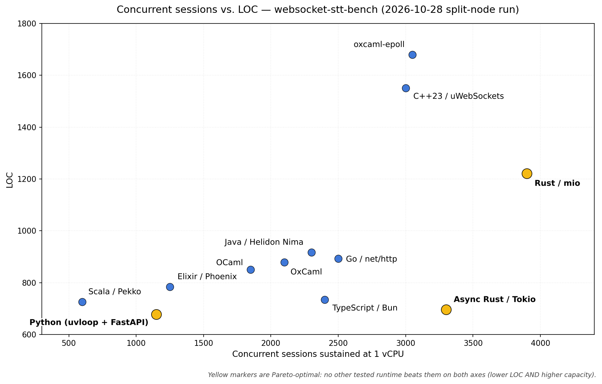
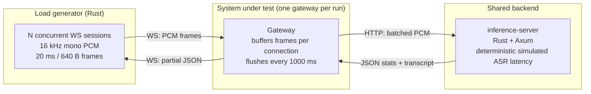

# websocket-stt-bench

## How many concurrent websocket audio-streaming sessions can modern runtimes sustain per vCPU?


This repo benchmarks streaming STT gateways behind one shared WebSocket protocol. Clients stream 16 kHz mono PCM at 20 ms / 640-byte frames; each gateway buffers per session, flushes every 1000 ms to a shared Rust inference simulator, and returns strict `partial` JSON messages.

Inspired by the [Benchmarks Game](https://benchmarksgame-team.pages.debian.net/benchmarksgame/index.html) and Karpathy's [autoresearch](https://github.com/karpathy/autoresearch).

## TL;DR

*Concurrent WebSocket sessions sustained inside the [SLO](#the-slo-what-passing-means):*

| Runtime | 1 vCPU | 2 vCPU | Bottleneck | App LOC | Details |
|---|---:|---:|---|---:|---|
| **[Rust 1.95](https://github.com/rust-lang/rust) — two `mio`/epoll threads, **no async runtime**** | **3900**¶ | **4400** (1.13X) | newest-p50 latency | 1221 | [runs](services/rust-sync/BENCHMARK.md) |
| **[Rust 1.95](https://github.com/rust-lang/rust) + async [Axum](https://github.com/tokio-rs/axum) / [Tokio](https://github.com/tokio-rs/tokio)** | **3300** | **5350** (1.62X) | newest-p95 latency | 696 | [runs](services/rust-axum/BENCHMARK.md) |
| **`oxcaml-epoll` — [OxCaml 5.2.0+ox](https://oxcaml.org/), Linux epoll, no Async** | 3050 | 3000§ (0.98X) | newest-p50 latency | 1.7k | [runs](services/ocaml-oxcaml-epoll/BENCHMARK.md) |
| **[C++23](https://en.cppreference.com/w/cpp/23) + [uWebSockets 20.77](https://github.com/uNetworking/uWebSockets)** | **3000**◆ | **5900**◆ (1.97X) | newest-p50 latency | 1.6k | [runs](services/cpp23-uwebsockets/BENCHMARK.md) |
| **[Go 1.26.10](https://go.dev/) + `net/http` / [`coder/websocket`](https://github.com/coder/websocket)** | 2500 | 3900 (1.56X) | latency | 893 | [runs](services/go-nethttp/BENCHMARK.md) |
| **[TypeScript](https://www.typescriptlang.org/) on [Bun 1.3.13](https://bun.sh/)** | 2400 | n/a | inference connection-reset errors; fetch caveat | 734 | [runs](services/typescript-bun/BENCHMARK.md) |
| **[Java 25 LTS](https://openjdk.org/projects/jdk/25/) + [Helidon Níma 4.3](https://helidon.io/)** | 2300 | 3600 (1.57X) | connect timeouts, then tail latency | 917 | [runs](services/java-helidon-nima/BENCHMARK.md) |
| **[OxCaml 5.2.0+ox](https://oxcaml.org/) + Async** | 2100 | 2100§ (1.00X) | CPU, single Async domain | 879 | [runs](services/ocaml-oxcaml/BENCHMARK.md) |
| **OCaml 5.4.1 + Async** | 1850 | 1850§ (1.00X) | CPU, single Async domain | 850 | [runs](services/ocaml-websocket-async/BENCHMARK.md) |
| **[Elixir 1.19.5](https://github.com/elixir-lang/elixir) + [Phoenix](https://github.com/phoenixframework/phoenix) / [Bandit](https://github.com/mtrudel/bandit)** | 1250 | 2100 (1.68X) | connect timeouts | 784 | [runs](services/elixir-phoenix/BENCHMARK.md) |
| **[CPython 3.14.4](https://github.com/python/cpython) + uvloop + FastAPI / Granian** | 1150 | 1500 (1.30X)† | CPU / newest-p50 latency | 678 | [runs](services/python-fastapi/BENCHMARK.md) |
| **[Scala 3.3 LTS](https://www.scala-lang.org/) + [Apache Pekko 1.6](https://pekko.apache.org/)** | 600 | 1150 (1.92X) | latency, then connect timeouts | 726 | [runs](services/scala-pekko/BENCHMARK.md) |
| **[CPython 3.14.4t](https://github.com/python/cpython) free-threaded + uvloop + FastAPI / Granian** | 175 | 200 (1.14X) | send/close timeout reliability | 678 | [runs](services/python-fastapi/BENCHMARK.md) |

**How these numbers were measured (2026-10-28 homelab re-run).** Split nodes: the gateway pod (1 vCPU / 2 GiB, or 2 vCPU / 2 GiB, for every runtime) and the loadgen ran on one k3s node, and a single 6-CPU inference replica ran on a second node across the LAN. Every measured partial was verified client-side for exact stub values and per-session sequence continuity, and any correctness error fails the point (every sweep point on the fixed images had zero). All 13 gateways first passed the 7-case in-cluster black-box conformance suite (golden multi-frame output, continuity, session isolation, 1002/1003 including 8193- and 65536-byte frames), run in two batches. The client payload also changed (deterministic, ~3% more inference-server CPU). Harness timings and the latency gates are unchanged from before; new are the correctness gate and once-per-failure error counting (re-scoring every point with the corrected error rule flips no verdicts). "Confirmed" means every repeat at that point passed (at least 2/2), bracketed within one step of the first failure.

These numbers are **not directly comparable** with the earlier single-node runs (inference co-located on the gateway node, 4 replicas), which remain as history in each service's BENCHMARK.md. What moved: C++ 1 vCPU 4350 → 3000 is attributable to the split setup, which costs it about 20% (co-located passed up to 4000 vs 3000-3200 split, single repeats; the previously published image does no better on split nodes). rust-sync 4400 → 3900 is not caused by the code changes (the `main` image on split nodes matches the fixed image: 3900 pass / 4000 fail); co-located, the fixed image also passes 3900 and fails 4400 (single repeats), so the split's share was not bracketed. rust-axum 2 vCPU 4250 → 5350 is not caused by the code changes (`main` on split passes 4250 and 5300). Scala 1400 → 600 is not caused by memory (4 GiB A/B, no restarts) or by the code changes: at 4 GiB the `main` image fails 900-1400 on latency plus errors as the fixed image does (connect timeouts at 1200/1400; at 900 its 142 errors were not timeouts), and at 600 it fails on 283 errors with ~19k of ~27k partials (sessions closed 1003 on TCP-split frames — the bug fixed here). The environmental causes are not isolated, and other shifts were not A/B-tested.

† Python 2 vCPU ran with `GRANIAN_LOOPS=2` / `WORKER_THREADS=2`. The earlier 1750 was reported as two worker processes; whether that shape difference explains the drop to 1500 was not isolated.
§ A single event loop / Async domain: a 2-vCPU pod doesn't use the second core, so 2 vCPU ≈ 1 vCPU. OxCaml's earlier two-replica fan-out figure (3350) wasn't re-measured.
¶ No async runtime, zero new dependencies, plain HTTP/1.1. Two OS threads — a `mio`/epoll WebSocket loop + a dedicated inference loop (`std::sync::mpsc` + `mio::Waker`). [runs](services/rust-sync/BENCHMARK.md).
◆ C++ 1 vCPU: 3000 confirmed (4/4); 3100 (3 pass / 1 fail, newest p50 202 ms) and 3200 (4 pass / 1 fail, newest p50 219 ms) are borderline; 3250 failed its single repeat and 3300 is the first solid fail (2/2). By A/B the split costs C++ about 20% (co-located passed up to 4000 vs 3000-3200 split, single repeats); one hypothesis, not tested, is the LAN hop plus its libcurl HTTP/2 client thread sharing the 1-vCPU quota. C++ 2 vCPU 5900 sits at the single inference replica's measured knee (clean at 6000 rps, saturating at 7000), so treat it as a lower bound that may be inference-limited.

LOC note: the TL;DR and chart use LOC. For OCaml raw-transport variants, that excludes the generic first-party WebSocket/HTTP/SHA-1/base64/masking transport shim that package-backed runtimes get from dependencies. Comments and blank lines are not counted.

The above numbers are the highest confirmed session counts that passed the SLO at the given vCPU shape. Detailed brackets, tables, and run notes live in the linked service benchmark docs.

**Hardware:** Intel Core i9-13900F, Ubuntu 24.04.3, k3s v1.35.4.

## Takeaways

*Written against the earlier single-node runs; the figures quoted below are those runs' numbers. On the 2026-10-28 split-node re-run, rust-sync still leads, async Rust now edges C++ at 1 vCPU (C++ loses about 20% to the split, see ◆), Go/Bun/Java reorder, and Scala drops (cause not isolated).*

- The biggest surprise: the per-vCPU leader is **Rust **, specifically a two-thread `mio`/epoll build (one WebSocket loop, one inference loop, plain HTTP/1.1, zero extra deps) at 4400 sessions/vCPU, just past C++ (4350).
- Async Rust is still the best *balance*: @ 696 LOC and 3475 sessions/vCPU, the leanest of the high-capacity tier even though raw-capacity now goes to the no-runtime Rust build. Both Claude Opus (max) and GPT 4.5 (xhigh) had no issue writing Rust.
- Tail-latency SLOs expose GC jitter. Passing requires p95 frame latency, not just average throughput, so allocation pressure, safepoints, and collection pauses can turn otherwise healthy throughput into latency cliffs. The size of that penalty is stack- and tuning-dependent, not a blanket verdict on every GC runtime.
- Two managed-runtime clusters show up. `oxcaml-epoll`, Java, Bun, and Go form the fast GC/managed tier around 2500-2900 sessions/vCPU, with the no-Async OxCaml epoll variant now ahead of Java on the 1-vCPU confirmed point. Actor-style runtimes cluster lower at 1 vCPU: Elixir/BEAM at 1250 and Scala/Pekko at 1400, though both land near 2200-2250 at 2 vCPU; Scala still has a connect-timeout caveat.
- BEAM scales vertically really well but dissapoints overall: Elixir trails at 1 vCPU but has the cleanest 1→2 vCPU lift. Similar story with Scala + actor framework. Perhaps this is a actor concurency model issue overall? TODO: investigate this.
- Bun is surprisingly competitive for a native WebSocket server path. It simply has no right beating Go and coming incredibly close to Java. Great job Bun! 👏
- OxCaml splits into two useful data points. The Async implementation got close-ish only after raw transport work: persistent keep-alive + zero-copy framing moved the confirmed ceiling from 1050 to 2075, then GC/runtime tuning plus a lighter session buffer lifted the latest 1-vCPU point to 2200. The separate `oxcaml-epoll` variant removes Async entirely; after widening its non-multiplexed HTTP/1.1 inference slot pool from 512 to 1024, it reached 2900 confirmed and 3000 borderline, where the failure shifted from pool-exhaustion error frames to newest-p50 latency. Jane Street looks to have made some noticeable improvements over OCaml with their fork. There are downsides as I couldn't use the standard async ocaml websockets framework with their fork, alas Claude had no problem writing a simple one from scratch. For a GC'ed non JVM language the perf seems impressive enough to me, it also reads extremely elegantly, only Elixir comes close.
- The stock OCaml gap was mostly transport: replacing `cohttp-async` + `websocket-async` with the same raw Async TCP shape moved stock OCaml to 1930, within about 7% of OxCaml's earlier raw-transport baseline before the later GC/buffer tuning.
- Free-threaded Python with this FastAPI/Granian stack has issues; TODO: investigate this.
- Some languages/runtimes were easier to prompt for than others. Rust and Python took me one or two prompts. C++ needed me to take over and repeatedly steer towards C++ concepts I have long forgotten (RAII, move semantics, etc); OxCaml was easy but building was downright painful (30m or so to build, OxCaml desperately needs better tooling like pre-built docker images).

**Pareto frontier (2026-10-28 numbers):** Python (678 LOC / 1150 sessions, leanest) · Async Rust/Tokio (696 LOC / 3300, best balance) · Rust/`mio` no-runtime (1221 LOC / 3900, most capacity). C++23 (1551 LOC / 3000) is dominated in this split-node run; with inference co-located it was already dominated by the no-runtime Rust build.

## The SLO: what "passing" means

"Passing" means every gate below holds against loadgen HDR histograms, per audio frame:

| Gate | Threshold | What it bounds |
|---|---:|---|
| **Newest-frame p50** | **≤ 200 ms** | Responsiveness to freshest audio in a flushed batch |
| Newest-frame p95 | ≤ 350 ms | Tail on fresh audio |
| **Oldest-frame p50** | **≤ 1200 ms** | Worst per-frame wait after the 1000 ms flush interval |
| Oldest-frame p95 | ≤ 1650 ms | Tail on oldest buffered audio |
| **Errors** | **≤ 1 / 100k partials** | Protocol errors (including timeouts) plus inference error frames |
| **Correctness** | **0 errors** | Every partial verified: wrong stub values, dropped or misattributed frames |

Errors count each failure once: `max(protocol_errors, sum of timeouts) + inference_errors` (a timed-out session is already a protocol error). A point also fails on any correctness error — a partial whose stub values don't match what the loadgen recomputes from the frames that session actually sent (so misattributed frames fail too), or a gap/overlap in the session's frame sequence (dropped or duplicated frames) — regardless of latency.

The error budget tolerates kernel/TCP stall noise while staying far tighter than typical production STT targets.

## What this experiment measures

The gateways share the same black-box WebSocket contract:

- `GET /ws/stt` upgrades to WebSocket; `GET /health` returns 200.
- Client sends `{"type":"start"}` as text, then 640-byte binary PCM frames at 50 fps.
- Gateway flushes every 1000 ms to a shared Rust inference simulator.
- Gateway holds at most one in-flight inference request per connection.
- Gateway returns strict `partial` JSON with `oldest_frame_seq`, `newest_frame_seq`, `flush_lateness_ms`, and `inflight_model_jobs`.
- Invalid first message closes with `1002`; invalid binary frame size closes with `1003`.

The shared inference server is deterministic and simulates GPU-style latency with log-normal jitter, batch wait, and long-tail spikes. It is not a real ASR model. Real ASR weights, authentication, multi-tenancy, segmentation, retry/reconnect logic, and VAD are intentionally out of scope.

## Architecture



## Code Shape

| Runtime | App LOC | Raw production LOC | Files | Implementation shape |
|---|---:|---:|---:|---|
| Python | 678 | 678 | 9 | Pydantic boundaries, uvloop/FastAPI, dual GIL/free-threaded runtime path |
| Async Rust/Axum | 696 | 696 | 6 | Tokio tasks, `Arc<Semaphore>::new(1)`, zero-copy `BytesMut` batching |
| TypeScript/Bun | 734 | 734 | 6 | `Bun.serve`, Valibot boundaries, bounded outbox |
| Elixir | 784 | 784 | 13 | Phoenix/Bandit raw `WebSock`, process-per-connection |
| Go | 893 | 893 | 6 | `net/http`, `coder/websocket`, h2c inference client |
| Java | 917 | 917 | 16 | Helidon Níma virtual threads, sealed outbound messages |
| Stock OCaml/Async | 850 | 1220 | 25 | raw `Async.Tcp`, hand-rolled RFC 6455, structural one-inflight flush loop |
| Rust/sync (`mio`) | 1221 | 1221 | 6 | two `mio` epoll loops on two OS threads (no async runtime), `mpsc`+`Waker` handoff, bounded shared inference pool |
| `oxcaml-epoll` | 1680 | 2126 | 15 | single Linux epoll loop, tiny C epoll stubs, fixed-frame WebSocket path, HTTP/1.1 inference slot pool |
| OxCaml | 879 | 1244 | 21 | raw `Async.Tcp`, hand-rolled RFC 6455, opaque inflight capability |
| C++23 | 1551 | 1551 | 11 | uWebSockets loop-per-thread, libcurl HTTP/2, Glaze JSON |

Application LOC is the chart count: code-only production lines after excluding blank/comment lines. For the OCaml raw-transport variants, it also excludes the generic first-party transport/crypto shim (`Base64`, `Sha1`, HTTP helpers, WebSocket framing/handshake, masking) that package-backed runtimes get from dependencies. Raw production LOC keeps every shipped first-party production line, including that shim. The no-runtime Rust gateway uses no such shim, so its two counts are equal.

The load-bearing invariant is one in-flight inference request per connection. Every implementation enforces it, but the expression differs: semaphore, atomic flag, token channel, process state, task guard, sequential flush loop, `Mvar`-backed capability, or — in the no-runtime Rust gateway — the single shared-pool inference slot a connection holds while its request is in flight.

## Which runtime?

| If you optimize for | Pick | Why |
|---|---|---|
| Lowest dollars per session | Rust/`mio` (no runtime) | 3900 sessions/vCPU, memory-safe, no async runtime — beats C++ |
| Leanest of the high-capacity tier | Async Rust/Axum | 3300 sessions/vCPU in 696 LOC |
| Maximum capacity in C++ | C++23/uWebSockets | 3000 sessions/vCPU split-node, 3100-3200 borderline (single-repeat A/B passed 4000 with inference co-located); best measured 2-vCPU (5900, inference-limited lower bound) |
| Rust-adjacent JVM capacity | Java/Helidon Níma | 2300 sessions/vCPU; edge fails on connect timeouts |
| Above-Java OxCaml capacity | `oxcaml-epoll` | 3050 sessions/vCPU; separate no-Async variant, newest-p50 latency edge at 3100 |
| JS ecosystem with strong capacity | TypeScript on Bun | 2400 sessions/vCPU on native Bun primitives |
| Go operational simplicity | Go/net-http | 2500 sessions/vCPU and explicit h2c transport |
| Vertical multi-core scale-up | Scala / Elixir / C++ | 1.92X / 1.68X / 1.97X lift 1→2 vCPU; Scala's is the largest whose 2-vCPU point is not at the inference knee (C++'s 5900 is an inference-limited lower bound) |
| Modeling invariants as types | OxCaml | opaque inflight capability, still runtime-enforced |
| Upstream OCaml without OxCaml | Stock OCaml/Async raw transport | within about 7% of the earlier OxCaml raw-transport baseline once transport is held roughly constant |
| Free-threaded Python | wait | this stack is reliability-limited |

My hot-take? If you're at a startup, start with async Python, iterate and once you need to do some cost savings, either commit to a full, coding agent driven, Rust rewrite, or swap out the bottlenck components via Rust-based cPython extension modules (serialization, websockets, etc). Else, just start in Rust. Yes, the hype is real!

## Reproducing

```sh
just doctor          # verify pinned tool versions
just check           # full per-language gate
just compose-build   # build all images
just conformance     # protocol contract check
just bench-ladder rust-axum-single ws://127.0.0.1:3000/ws/stt
```

Local Compose runs the `single` or `multi` profile one at a time because profiles share host ports. Multi-vCPU capacity claims should be verified in-cluster; Compose under-reports once the gateway outpaces the in-VM inference simulator.

For reproducible Kubernetes runs, use `charts/stt-bench/` and `charts/stt-bench/README.md`. The chart renders the inference server, gateway Deployments, suspended loadgen/inferbench Jobs, and results PVC. Analysis uses paired `*.summary.json` / `*.samples.csv` artifacts:

```sh
just analyze-results <input-dir> <output-dir>
```

## Environment

- **Load generator:** `loadgen/rust/`, `tokio-tungstenite`, HDR histograms, strict `partial` validation.
- **k3s node:** Intel Core i9-13900F, 32 logical CPUs, 64 GiB RAM, Ubuntu 24.04.3, k3s v1.35.4.
- **2026-10-28 re-run:** gateway + loadgen on that node; the shared inference server (one 6-CPU replica) on a second 8-CPU k3s node, reached over the LAN.
- **Scheduling caveat:** Kubernetes CPU requests/limits are CFS quota, not CPU affinity; edge points can move with P/E-core migration on this hybrid CPU. Repeats and raw sample CSVs are the evidence.
- **Pinned versions:** `versions.lock.toml`.

## Known gaps

The current setup models compute saturation but not every backpressure path. Open: bounded per-connection input buffers with overflow policy, client-side send-wait time as a KPI, per-connection queue/drop metrics, a cross-connection job-queue limit, and overload conformance/stress checks.

**Inference-server placement:** local Compose under-reports fast gateway capacity once the gateway can outpace the in-VM simulator. Use the in-cluster path for capacity claims.

## Disclosure

This repo was created with assistance from ChatGPT 5.5 and Claude Opus 4.7.
